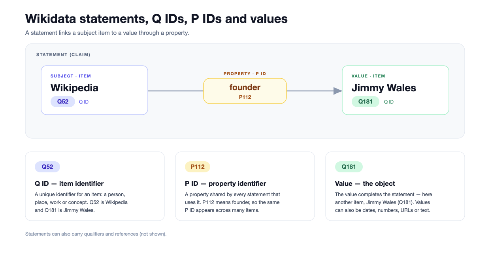

# KOF2026wikidatamcp

Interactive Wikidata knowledge-graph demo.

[](figures/wikidata_statement.svg)

## Streamlit app

`app.py` renders the outgoing direct claims of a Wikidata entity (default
[Q52 — Wikipedia](https://www.wikidata.org/wiki/Q52)) as an interactive
force-directed graph. Data is fetched live from the
[Wikidata Query Service](https://query.wikidata.org) via SPARQL and cached for
one hour. Literal values (external IDs, URLs, filenames, strings) are grouped
into one node per property; hover a node to inspect its values. Clicking a node
shows the property names on its edges; the click is handled in the browser, so
the graph layout and the current zoom/pan are never reset.

Environment setup uses [uv](https://docs.astral.sh/uv/):

```sh
uv venv --python 3.12 .venv
uv pip install --python .venv/bin/python -r requirements.txt
```

Run the app:

```sh
.venv/bin/streamlit run app.py
```

Then open <http://localhost:8501>.

## Wikidata MCP

The project also configures the
[Wikimedia Wikidata MCP server](https://wd-mcp.wmcloud.org/mcp/) in
`opencode.json` for agent-assisted exploration:

```sh
opencode mcp list
```
